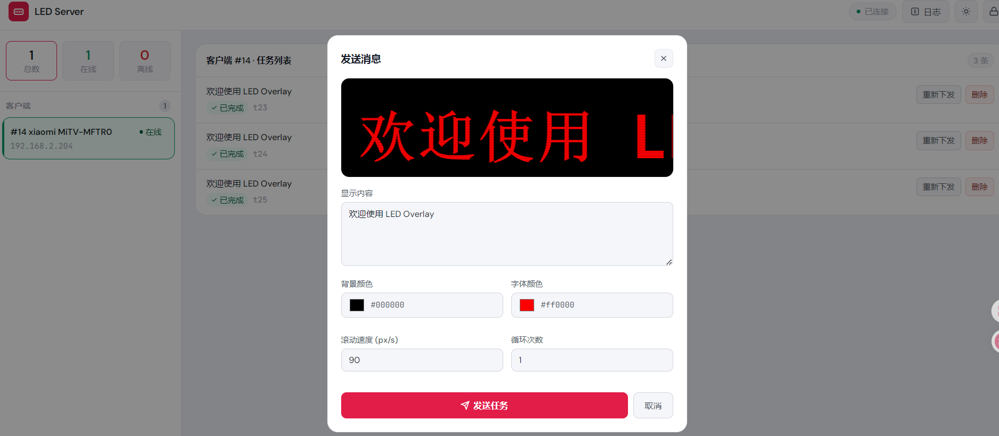
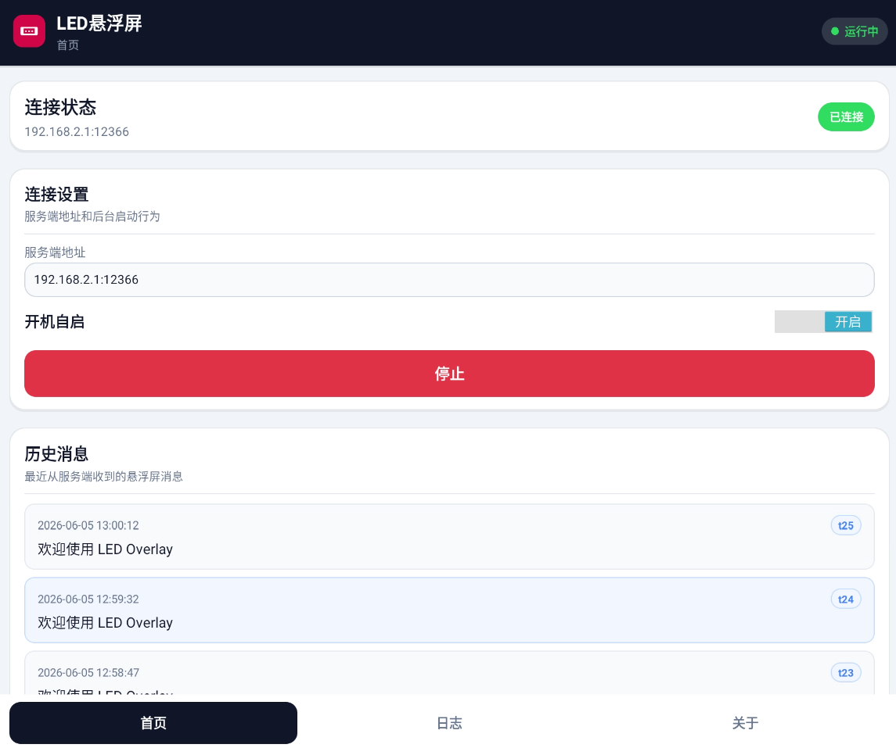
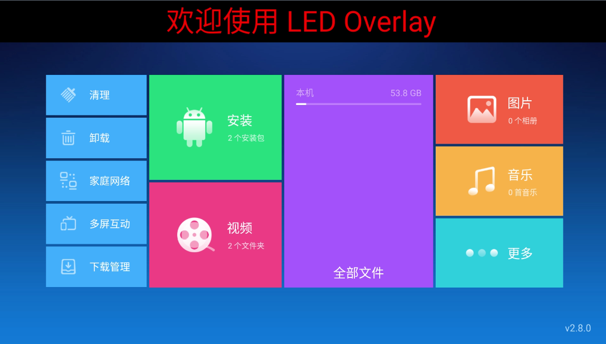

<p align="center">
  
</p>

<h1 align="center">LED Overlay</h1>

<p align="center">
  远程 LED 悬浮屏消息下发系统：一个原生 C 服务端后台 + 一个 Android 悬浮窗客户端。通过服务端下发消息，安卓客户端悬浮滚动显示消息。
</p>

<p align="center">
  <a href="https://deepwiki.com/lmq8267/led-overlay"></a>
  
  
  
</p>

## 项目概览

LED Overlay 用于把服务端管理页面创建的短文本消息实时下发到 Android 设备，并在设备上以全屏悬浮窗形式显示。它适合局域网提示屏、临时通知屏、测试用 LED Overlay、简易排队提示等场景。

当前仓库由两部分组成：

- `server/`：原生 C 写成的服务端，内嵌 Web 管理页面，提供客户端 WebSocket、后台 WebSocket、HTTP ACK 兜底接口和状态持久化。
- `android/app/`：Android 客户端，负责连接服务端、接收消息、显示悬浮窗、记录本机日志和历史消息。

## UI 预览

| 服务端主页 | Android 首页 | 悬浮屏显示 |
| --- | --- | --- |
|  |  |  |

## 核心能力

- 服务端单文件二进制部署，默认监听 `0.0.0.0:12366`。
- 管理主页内嵌进服务端二进制，不依赖 Node.js、Nginx 或外部静态文件。
- Android 客户端通过 WebSocket 接收消息，通过 HTTP `/client-ack` 上报完成状态；HTTP ACK 必须带服务端在 `hello-ok` 中下发的临时密钥。
- 支持消息状态流转：`pending`、`sent`、`received`、`displaying`、`completed`、`failed`。
- 支持客户端在线/离线状态、任务列表、日志抽屉、历史消息记录。
- 支持管理密码、登录会话、登录失败锁定和隐藏主页路径。
- 支持 Android 悬浮窗权限、通知权限、电池优化提示、开机自启开关。
- 服务端状态写入 `/var/lib/led-overlay/state.db`，日志保留最近 300 条。

## 架构

```text
┌─────────────────────┐
│   Web 管理页面       │
│   / 或 --home-path   │
└──────────┬──────────┘
           │ WebSocket /admin
           │ HTTP /change-password
┌──────────▼──────────┐
│   led_server         │
│   C 单二进制服务端    │
└──────────┬──────────┘
           │ WebSocket /client
           │ HTTP POST /client-ack
┌──────────▼──────────┐
│   Android 客户端      │
│   前台服务 + 悬浮窗    │
└─────────────────────┘
```

## 服务端接口

| 路径 | 类型 | 认证 | 用途 |
| --- | --- | --- | --- |
| `/` 或 `--home-path` | HTTP | 需要登录 | 管理主页入口 |
| `/login` | HTTP POST | 否 | 管理登录 |
| `/admin` | WebSocket | 需要会话 | 管理页面实时状态与操作 |
| `/client` | WebSocket | 否 | Android 客户端连接与接收消息 |
| `/client-ack` | HTTP POST | 客户端 ACK 密钥 | 客户端完成 ACK 兜底上报 |
| `/change-password` | HTTP POST | 需要会话 | 修改管理密码 |

`/client-ack` 的密钥不是长期凭据：每次 WebSocket `hello` 都会重新生成，只在本次连接期间有效。服务端默认不信任 `X-Real-IP` / `X-Forwarded-For`，只有部署在可信反向代理后面时才使用 `--trust-proxy`，否则登录失败锁定可以被伪造转发头绕过。

客户端消息示例：

```json
{
  "type": "message",
  "taskId": "t42",
  "text": "欢迎使用 LED Overlay",
  "background": "#000000",
  "foreground": "#ff0000",
  "speed": 90,
  "loops": 1
}
```

客户端 ACK 示例：

```json
{
  "type": "ack",
  "clientId": "android-client-id",
  "taskId": "t42",
  "status": "completed",
  "detail": "客户端显示完成"
}
```

## 构建服务端

服务端只依赖系统 C 工具链和 POSIX/pthread 能力。

```bash
cd server
make
```

构建最小体积版本：

```bash
cd server
make min
```

清理产物：

```bash
cd server
make clean
```

运行服务端：

```bash
./led_server -a 0.0.0.0 -p 12366
```

常用参数：

```bash
./led_server --help
./led_server --version
./led_server -P 默认密码
./led_server --reset-password 新密码
./led_server --home-path /hidden-admin
./led_server --trust-proxy
```

首次启动如果没有持久化密码，会创建默认密码 `admin`。也可以用 `-P` 或 `--default-password` 指定状态文件缺失、异常或未保存密码时使用的默认密码。已有持久化密码不会被默认密码覆盖；正式使用前应立即在页面中修改密码，或使用 `--reset-password` 初始化。

## 构建 Android 客户端

项目使用 Android Gradle Plugin `8.5.2`，模块名为 `:app`。

```bash
gradle :app:assembleDebug
```

安装后在APP首页填写服务端地址，例如：

```text
192.168.8.185:12366
ws://192.168.8.185:12366/client
http://192.168.8.185:12366
```

客户端会自动规范化为 WebSocket 候选地址，并在 HTTP ACK 时使用对应的 `/client-ack`。

## Android 权限

客户端需要以下权限才能稳定工作：

- `INTERNET`：连接服务端。
- `SYSTEM_ALERT_WINDOW`：显示悬浮窗。
- `FOREGROUND_SERVICE` / `FOREGROUND_SERVICE_SPECIAL_USE`：保持后台连接。
- `POST_NOTIFICATIONS`：Android 13+ 前台服务通知。
- `RECEIVE_BOOT_COMPLETED`：开机后尝试恢复。
- **通知使用权**（`NotificationListenerService`）：电视上常常没有系统入口，只能 `adb shell cmd notification allow_listener`；有入口的机型可以在「设置 → 通知使用权」里手动勾选。它不读取通知内容，只作为“被系统强停后重新绑定进程”的存活锚点。
- `AUTHENTICATE_ACCOUNTS` / `READ_SYNC_SETTINGS` / `WRITE_SYNC_SETTINGS`：安装时自动授予，不需要用户确认，也不需要 ADB。用于同步框架自愈（见下文）。

不同厂商系统对后台运行、开机自启、悬浮窗权限限制不同。客户端首页的权限状态卡片用于快速检查这些前置条件。

## 快速开始（复制即用）

电视和电脑在同一个局域网，电视已打开开发者选项里的 USB / 网络调试。APK 从 [Releases](https://github.com/lmq8267/led-overlay/releases) 下载，文件名通常是 `led-overlay-android.apk`；下面的 IP 和文件名按实际情况替换。

```bash
# 1. 连接（首次需要在电视上点「允许」授权这台电脑）
adb connect 192.168.1.100:5555
adb devices

# 2. 安装（-r 覆盖安装，保留数据）
adb install -r led-overlay-android.apk

# 3. 一次性授权（跟着包走，重启不丢；卸载重装才需要重做）
adb shell appops set com.lmq8267.ledclient SYSTEM_ALERT_WINDOW allow
adb shell appops set com.lmq8267.ledclient RUN_IN_BACKGROUND allow
adb shell appops set com.lmq8267.ledclient RUN_ANY_IN_BACKGROUND allow
adb shell pm grant com.lmq8267.ledclient android.permission.POST_NOTIFICATIONS
adb shell dumpsys deviceidle whitelist +com.lmq8267.ledclient
adb shell cmd notification allow_listener com.lmq8267.ledclient/com.lmq8267.ledclient.LedNotifProbe

# 4. 打开一次应用，让它注册同步账户、作业和闹钟
adb shell monkey -p com.lmq8267.ledclient -c android.intent.category.LAUNCHER 1

# 5. 验证
adb shell appops get com.lmq8267.ledclient | grep -E "SYSTEM_ALERT_WINDOW|RUN_ANY_IN_BACKGROUND"
adb shell settings get secure enabled_notification_listeners | grep ledclient
adb shell dumpsys jobscheduler | grep -i ledclient
adb shell dumpsys account | grep -i ledclient
```

说明：

- 第 3 步的 `POST_NOTIFICATIONS` 只有 Android 13+ 存在，低版本会报 `not a changeable permission type`，忽略即可。
- `cmd notification allow_listener` 在部分老固件上不存在，改用下面这条（会覆盖整个列表，已有其他监听器时先 `settings get` 读出来用冒号拼接；`docs/adb_grant.sh` / `.bat` 已自动处理）：
  ```bash
  adb shell settings put secure enabled_notification_listeners com.lmq8267.ledclient/com.lmq8267.ledclient.LedNotifProbe
  ```
- **不需要** `WRITE_SECURE_SETTINGS`：同步自愈不依赖它，未授权时也能注册。
- 装完建议在系统的「应用管理」里允许自启动和后台运行；没有该入口的固件只能靠 JobScheduler、同步框架和通知监听兜底。
- 不想用 adb 也可以：应用内「权限状态」卡片的悬浮窗、通知权限、通知使用权、电池优化、开机自启都能跳系统页手动处理（开机自启跳的是应用详情，再进「应用管理/自启动」放行）。只有电视裁掉了通知使用权或悬浮窗入口时才必须用 adb。
- 想省事可以直接跑 `docs/adb_grant.sh`（Linux/macOS/WSL）或 `docs/adb_grant.bat`（Windows），它会交互式完成上面的连接、检查、授权和验证。

### 在电视内直接执行（手机 adb 软件 / 电视终端）

手机上的 adb 工具（LADB、AdbShell、甲壳虫 ADB 助手等）连上电视后，进去就是一个**电视本机的 shell**，里面没有 `adb` 这个命令。所以不要把 `adb shell` 一起粘进去，只输入后面的部分。

1. 在手机的 adb 工具里填电视 IP 和端口（默认 `5555`）并连接，电视弹「允许 USB 调试」时点允许。这一句是工具界面里的操作，不是在 shell 里敲 `connect`。
2. 把 APK 放到电视能读到的位置（U 盘、手机传输工具、或电视浏览器下载到 `/sdcard/Download/`），然后安装：
   ```sh
   pm install -r /sdcard/Download/led-overlay-android.apk
   ```
3. 授权（在电视 shell 里逐条粘贴）：
   ```sh
   appops set com.lmq8267.ledclient SYSTEM_ALERT_WINDOW allow
   appops set com.lmq8267.ledclient RUN_IN_BACKGROUND allow
   appops set com.lmq8267.ledclient RUN_ANY_IN_BACKGROUND allow
   pm grant com.lmq8267.ledclient android.permission.POST_NOTIFICATIONS
   dumpsys deviceidle whitelist +com.lmq8267.ledclient
   cmd notification allow_listener com.lmq8267.ledclient/com.lmq8267.ledclient.LedNotifProbe
   ```
4. 打开一次应用并验证：
   ```sh
   monkey -p com.lmq8267.ledclient -c android.intent.category.LAUNCHER 1
   appops get com.lmq8267.ledclient
   settings get secure enabled_notification_listeners
   dumpsys jobscheduler | grep -i ledclient
   dumpsys account | grep -i ledclient
   ```

和电脑版的区别只有前缀：电脑上写 `adb shell xxx`，电视 shell 里写 `xxx`。执行身份都是 `shell`（uid 2000），效果完全一样。

`pm grant POST_NOTIFICATIONS` 在 Android 13 以下会报 `not a changeable permission type`，忽略。`cmd notification` 不存在的老固件改用：

```sh
settings put secure enabled_notification_listeners com.lmq8267.ledclient/com.lmq8267.ledclient.LedNotifProbe
```

## TV 端说明

电视端不再把 WebSocket 和悬浮窗放在无障碍服务里，并且已经彻底移除无障碍服务。原因是在 Xiaomi TV（MiTV-MFTR0，Android 11 / 14）上实测：强停后无障碍授权会被系统清空，服务不会重新绑定；而系统会重新绑定已授权的通知监听，顺带把进程拉回来。保留一个无效的备用入口只会误导用户。

当前 TV 端结构：

- `LedService` 是唯一的 WebSocket / 任务队列 / ACK / 悬浮窗宿主，使用 `specialUse` 前台服务；从最近任务划掉后 2 秒、有序停止后 5 秒用不精确闹钟自动重启（用户点“停止”时不排）。每次启动会把 `via`（`boot` / `job` / `alarm` / `guard-sync` / `notification_listener` / `task` / `destroy` / `app`）写进日志页，用来归因“这次是谁拉起的”。
- `LedNotifProbe`（`NotificationListenerService`）只等系统重绑，然后按 2s/5s/10s/20s/40s/60s 分档恢复 `LedService`（约 2 分钟收口）；不读取通知标题或正文。
- `Watchdog`（`JobService`）每 15 分钟检查一次，`AlarmManager` 再排一条 15 分钟的兜底闹钟。两者都只发“恢复意图”，由 `KeepAlive` 判断屏幕状态。注意小米 `killAllThirdApp` 强停会连带取消作业和闹钟，它们覆盖的是“只杀进程”那一档。
- `GuardSync` 把同步适配器挂在系统 `settings` authority 上：系统每次写设置（开机、唤醒、调音量、切信号源）都会触发一次本地同步，SyncManager 随之显式 bind 本进程。它是应用内唯一能在强停后清掉 `stopped` 标记的通道，不做任何数据交换，也不需要 ADB。代价是系统“账户”列表里会出现一个 `LedOverlay` 条目。Android 12+ 在后台启动前台服务需要豁免，本通道依赖已授予的悬浮窗权限（与客户端正常工作的前提相同）。
- 屏幕黑着时不会立即启动前台服务，而是等 `SCREEN_ON`，避免把待机中的电视点亮。
- “运行中”由服务心跳判断，`running` 不再等同于用户意图；用户按“停止”后即使进程被系统重启也不会自动恢复，同时会取消作业、闹钟与同步。

推荐 TV 端部署流程：

```text
1. 打开电视开发者选项和网络 ADB 调试，确认电视 IP 和 ADB 端口，常见端口为 5555。
2. 在同一局域网电脑上 adb connect <电视IP>:5555，电视弹「允许 USB 调试」时点允许。
3. 安装客户端：adb install -r <apk>，或先拷到电视再用 pm install -r 安装。
4. 运行 docs/adb_grant.sh 或 docs/adb_grant.bat 完成一次性授权。
5. 回到 APP 首页填写服务端地址，点击启动。
6. 验证：先按遥控器电源键待机再唤醒、或断电冷启动，确认服务能起来；再执行
   `adb shell am force-stop com.lmq8267.ledclient` 验证强停后的恢复。
   注意强停会把包置为 stopped，恢复不是立即的：通知监听可能几秒内重绑，
   否则要等一次系统设置写入触发同步，最长约 15 分钟的周期同步，不是秒回。
```

授权完成后可以按下面的命令单独验证通知监听是否生效：

```bash
adb shell settings get secure enabled_notification_listeners
# 输出里应包含 com.lmq8267.ledclient/...
```

注意：ADB 网络调试属于高权限入口，只建议在可信局域网内临时开启。授权完成并确认运行稳定后，可按设备安全策略关闭不必要的调试入口。

## docs ADB 脚本说明

`docs/adb_grant.sh` 和 `docs/adb_grant.bat` 用于给 TV 端一键设置运行所需权限。两个脚本功能一致，只是运行平台不同：

| 脚本 | 运行环境 | 用途 |
| --- | --- | --- |
| `docs/adb_grant.sh` | Linux / macOS / WSL / Git Bash | 通过交互式命令连接电视 ADB，并设置权限 |
| `docs/adb_grant.bat` | Windows CMD | 通过交互式命令连接电视 ADB，并设置权限 |

脚本会执行的主要操作：

- 检查本机是否已安装 `adb`，并校验输入的 IP 地址。
- 连接电视、检查调试授权，并用 `pm path` 确认应用已经安装（没装会直接退出，避免后面全是无效操作）。
- 设置 `SYSTEM_ALERT_WINDOW`、`RUN_IN_BACKGROUND`、`RUN_ANY_IN_BACKGROUND`。
- 授予 `POST_NOTIFICATIONS`（Android 13+，低版本失败自动忽略）并加入电池优化白名单。
- 授予通知使用权：`adb shell cmd notification allow_listener com.lmq8267.ledclient/com.lmq8267.ledclient.LedNotifProbe`；老固件不支持时自动退回 `settings put secure enabled_notification_listeners`。
- 验证 appops 与通知使用权，以及应用启动后才会出现的 `JobScheduler` 作业和同步账户。

Linux / macOS 使用：

```bash
cd docs
chmod +x adb_grant.sh
./adb_grant.sh
```

Windows 使用：

```bat
cd docs
adb_grant.bat
```

如果脚本提示 `adb 未授权或设备离线`，请查看电视屏幕上的 USB 调试授权弹窗，选择允许后按脚本提示重试。脚本每次都会重新确认通知使用权，不会因为某项授权已存在就提前退出。

## 状态与持久化

服务端状态文件：

```text
/var/lib/led-overlay/state.db
```

该文件保存客户端、任务、日志和管理密码哈希。它是服务端自维护的文本状态文件，不是 SQLite 数据库。服务端日志会写入该状态文件，并限制为最近 300 条，避免无限增长。目录权限为 `0700`、文件为 `0600`，写入后执行 `fsync`。旧版本曾把登录失败时的明文密码写进日志；升级后请清空管理页日志并修改一次密码。

Android 客户端本地使用 `SharedPreferences` 保存：

- 服务端地址和最近 3 个历史地址。
- 用户是否启用（`enabled`）、服务是否活着（心跳时间）、连接状态。
- 已接收/已完成任务记忆。
- 待补发 ACK。

任务去重按“规范化服务端地址 + taskId”记录，避免切换服务端后因为任务编号重复而跳过显示。

## 连接与 ACK 策略

客户端通过 `/client` WebSocket 保持连接并接收消息。收到消息后会进入本地显示队列，显示完成后通过 HTTP `/client-ack` 上报 `completed`。

这样处理的原因是：Android 后台、悬浮窗显示和厂商省电策略可能让 WebSocket 写入不稳定，但 HTTP 短连接上报完成状态更可靠。WebSocket 仍用于服务端实时下发消息和连接在线状态。

连接保活分三层：

1. `LedService` 每 5 秒写一次本机心跳；首页用“心跳是否新鲜”判断服务是否真的活着，而不是只看一个布尔值。
2. `WsClient` 每 20 秒发一次 `{"type":"ping"}`。服务端回 `{"type":"pong"}`；连续 3 个周期收不到 pong 就主动断开重连。旧版服务端不回 pong 时不会误判。
3. 系统网络恢复时通过 `NetworkCallback` 立即打断旧 socket，让重连循环马上执行，不必等下一次 5 秒轮询。

## 常见问题

### 按电源键 / 切后台后客户端消失

- 先确认通知使用权已授予：`adb shell settings get secure enabled_notification_listeners` 输出里应包含本应用。
- Xiaomi TV 会在电源键/切后台时对第三方应用执行 `force-stop`，`START_STICKY`、开机广播、JobScheduler 和 `AlarmManager` 都会失效（强停会取消作业、清空闹钟，并把包置为 `stopped`，被强停的包收不到开机广播）。现在的恢复顺序是：通知监听重绑 → 同步框架被系统 bind（需要系统“自动同步”总开关未关）→ 两者都没生效时只能等下次开机或用户手动打开。
- 在没有通知使用权的情况下，按 Home 后进程被强停不会再自动恢复，这是系统行为，不是应用崩溃。
- 判断同步自愈是否生效：`adb logcat -s LedOverlay` 里搜“同步自愈账户已注册”，或 `adb shell dumpsys account | grep ledclient` 看账户条目；`adb shell dumpsys content | grep -i ledclient` 能看到 `LOCAL` 或 `PERIODIC` 同步记录。

### 首页显示“恢复中”一直不变成“运行中”

- 说明用户已经点了启动，但服务心跳没有更新：通常是系统把进程强停了，或者前台服务被固件拦截。
- 检查 `adb logcat -s LedOverlay` 里有没有「服务启动 via=…」「通知监听已连接」「保活启动」「服务创建」。`via` 会直接说明这次是被 `boot` / `job` / `alarm` / `guard-sync` / `notification_listener` / `task` / `destroy` 里的哪条通道拉起的。
- 确认按钮处于“停止”状态（表示用户意图是开启），再按一次“停止”后重新“启动”，观察日志。

### 首页显示连接中，但服务端显示在线

- 通常是客户端 UI 状态没有刷新，或旧连接的关闭回调覆盖了新连接状态。当前实现中首页每秒读取一次连接状态，服务端同地址重复启动时也会按真实 socket 状态刷新。

### 消息没有显示却立即完成

- 优先检查是否切换过服务端并复用了相同 `taskId`。当前实现已经按服务端地址隔离任务记忆。如果服务端以后下发 `createdAt`，可以进一步升级为“服务端地址 + taskId + 创建时间”的去重键。

### 颜色解析失败

- 消息颜色必须是 Android 可解析的颜色值，例如 `#000000`、`#ff0000`。类似 `#ffoo0o` 这种包含字母 `o` 的值不是合法十六进制颜色。

### 默认密码提示仍出现

- 服务端只有在状态文件中没有密码哈希时才会创建默认密码并提示。请确认运行中的服务端读取的是同一个 `/var/lib/led-overlay/state.db`，以及修改密码后服务端有权限写回该文件。
